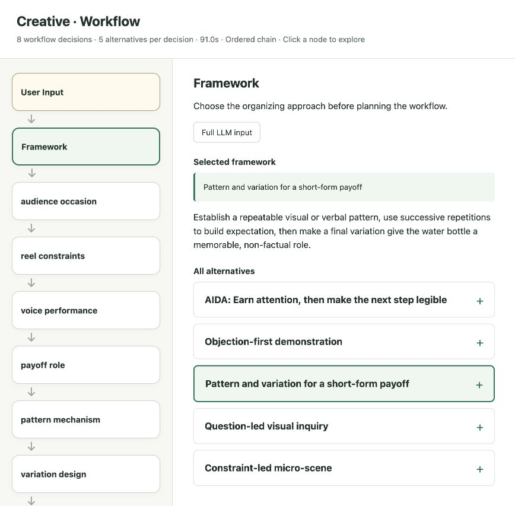
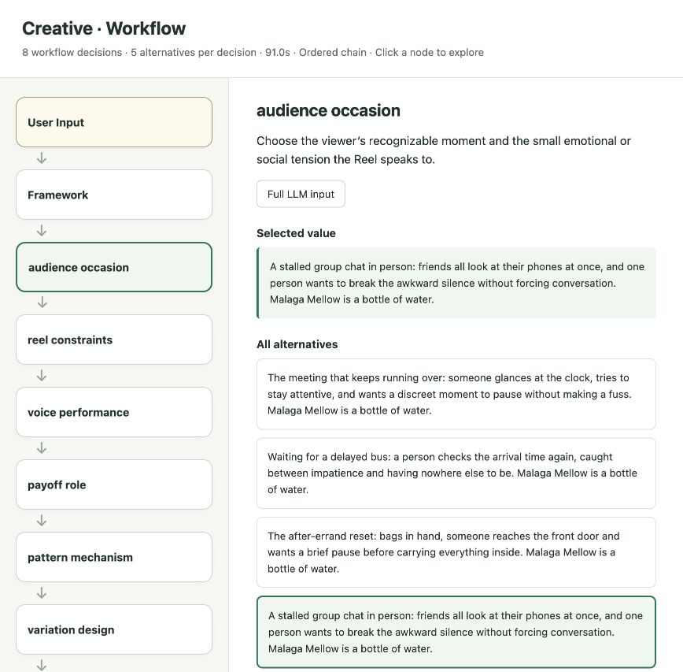

# Creative

**Let models propose. Let randomness decide.**

Creative turns a brief into a framework-led workflow, generates alternatives for each decision,
and uses code-backed randomness to select a path. Later steps develop the consequences of
those choices into a finished ad, story, strategy, or product concept.

Choose between two approaches to the same process:

| Approach | Where it runs | What you need |
| --- | --- | --- |
| [Skill in your harness](#skill-in-your-harness) | One LLM context in your existing agent harness | The skill prompt and a code execution tool |
| [External Creative Service](#external-creative-service) | This Python application, via CLI, REST, or MCP | Python, uv, and configured provider credentials |

[](https://github.com/TheValmarAI/creative/actions/workflows/checks.yml)
[](pyproject.toml)
[](LICENSE)

## Skill in your harness

Load [`skills/creative-workflow/SKILL.md`](skills/creative-workflow/SKILL.md) into your harness
as a skill, or use its contents as the instructions for a creative request. The folder contains
just one prompt; no service installation, Gateway configuration, or project code is required.

For a harness that discovers skill folders, copy `skills/creative-workflow` into its configured
skills directory. Then invoke it using your harness's normal skill mechanism, for example:

```text
Use the creative-workflow skill. Generate a TikTok ad for a bottle of water called
Malaga Mellow. Use k=5 alternatives at each decision.
```

One LLM creates the framework pool, plans the workflow, generates alternatives step by step,
and writes the final work in a single context. After each pool it executes a code selector
using `secrets.randbelow(k)` and develops the returned selection. The prompt includes a minimal
Python selector, instructions for substantive variety, and a reviewable record of choices.
The default is k=20; the user can override it.

The harness must support code execution. A model claiming to pick randomly is not a substitute.
A shared context also cannot truly hide earlier text or unselected alternatives from the model;
cue-only inspiration is a working discipline here. Keep the workflow and pool lengths within
the model's context window. Use the external service when you want separately scoped model
calls, typed validation, reusable interfaces, and the visualizer.

## External Creative Service

The application has one async Python core and three interfaces: **CLI, REST API, and MCP**.
It uses [Pydantic AI](https://ai.pydantic.dev/) with swappable models and Pydantic AI Gateway
support. Each role runs as a separately scoped call; Python handles selection and execution.



### Quick start

Install [uv](https://docs.astral.sh/uv/), then:

```sh
git clone https://github.com/TheValmarAI/creative.git
cd creative
uv sync --locked
cp .env.example .env
```

Add your [Pydantic AI Gateway](https://pydantic.dev/docs/ai/overview/gateway/) key to `.env`:

```dotenv
PYDANTIC_AI_GATEWAY_API_KEY=your-gateway-key
```

Run a brief and open its workflow:

```sh
uv run creative \
  "Write an ad for a bottle of water called Malaga Mellow. Make it a TikTok reel." \
  --candidate-count 5 --visualize
```

Generation uses your configured provider account. The default model is
`gateway/openai-responses:gpt-6-luna`; change `AI_MODEL` to use another supported model.

### How it works

```text
Your brief
   ↓
N suitable frameworks → random framework
   ↓
A tailored, ordered workflow
   ↓
N alternatives → random selection, at each step
   ↓
Finished work + explanation of the selected choices
```

1. **Choose an approach.** Node 0 proposes suitable frameworks, prioritizing established
   methods with honest attribution. Python selects one before the remaining workflow is planned.
2. **Plan consequential decisions.** Broad differences come before details. Each node owns
   one decision and explains how it advances the selected framework.
3. **Explore and select.** Each node produces `N` alternatives. Python selects uniformly with
   `secrets.randbelow(N)`; the LLM does not rank or choose them.
4. **Develop the combination.** Normal nodes see the brief, framework, and all earlier
   selections. An `isolated_context` node sees only its neutral instructions and cue, providing
   outside inspiration for later integration.
5. **Compose the result.** The writer develops the locked selections into the requested work
   and explains their effects, interactions, and relevant assumptions.

The default is **20 alternatives per node**, configurable in `.env` or per request. Workflows
contain at most 23 decision nodes after Node 0. They execute sequentially; separate requests
can run concurrently. There is no database, task queue, or separate frontend service.

Random selection guarantees neither originality nor semantic correctness. The framework,
workflow, selections, and optional candidate pools make the process inspectable.

See the [worked story example](docs/workflow-example.md) for a complete walkthrough.

### CLI

```sh
# Just the finished output.
uv run creative "Suggest a growth strategy for an independent bicycle repair shop."

# Watch the steps, alternatives, selections, and provider retries.
uv run creative "Outline a story about a lighthouse keeper." --verbose

# Open the workflow; save the full structured result separately.
uv run creative "Design an unusual onboarding experience." --visualize --json > result.json
```

| Option | What it does |
| --- | --- |
| `--candidate-count N` | Override the candidate count for this run; accepts 1–100 |
| `--verbose`, `-v` | Print live progress and candidate pools to stderr |
| `--visualize` | Open an interactive workflow when generation completes |
| `--json` | Return the full result, including candidate pools, on stdout |

Progress stays on stderr, so stdout can be redirected to a file. Ctrl+C cancels in-flight work.
Run `uv run creative --help` for the CLI reference.

### Visualizer

The visualizer opens as a self-contained local HTML file. No server or JavaScript build is
needed. Its path is printed to stderr so you can reopen it later.

- Follow the vertical list from **User Input** through **Framework** to **Finished output**.
- Click a decision to inspect its selected value and all alternatives.
- Expand a named framework card to read its complete contract.
- Click **Full LLM input** to see the model and captured prompt in a read-only text box.



Prompt capture is enabled for `--visualize`. The resulting file contains your input, generated
content, and model inputs; treat it like the original brief. It is saved privately in the
system temporary directory. Ordinary server logs do not include those contents.

### REST API and MCP

```sh
uv run creative-api
```

| Interface | Local URL |
| --- | --- |
| REST | `http://127.0.0.1:8000/v1/generate` |
| MCP, Streamable HTTP | `http://127.0.0.1:8000/mcp` |
| OpenAPI docs | `http://127.0.0.1:8000/docs` |
| Health | `http://127.0.0.1:8000/healthz` |

```sh
curl --max-time 660 http://127.0.0.1:8000/v1/generate \
  -H 'Content-Type: application/json' \
  -d '{"prompt":"Propose a bicycle repair shop growth strategy.","candidate_count":5}'
```

MCP exposes the equivalent `generate_creative` tool:

```json
{
  "name": "generate_creative",
  "arguments": {
    "prompt": "Propose a bicycle repair shop growth strategy.",
    "candidate_count": 5,
    "include_candidates": true
  }
}
```

Set `API_TOKEN` to protect both interfaces with `Authorization: Bearer <token>`.
Unauthenticated development is limited to localhost. Generation waits for completion; configure
client and proxy timeouts accordingly.

See [configuration and operations](docs/configuration.md) for model switching, authentication,
observability, Docker, limits, and response contracts.

### Development

```sh
uv sync --locked
uv run ruff check .
uv run ruff format --check .
uv run pytest -q
```

Normal tests disable paid model requests. They exercise the engine, real provider adapters
with mocked HTTP, and REST/MCP over both ASGI and a local TCP server. A separate opt-in live
smoke test is documented in [CONTRIBUTING.md](CONTRIBUTING.md).

```text
src/creative/
├── core/          # workflow engine, typed contracts, prompts, model adapters
└── interfaces/    # CLI, FastAPI, MCP, and local visualizer
```

[Contributions welcome](CONTRIBUTING.md). Released under the [MIT license](LICENSE).
